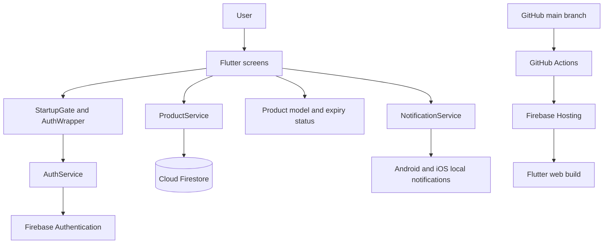

# ShelfSense architecture

ShelfSense is a Flutter application for tracking everyday products and their
expiry dates. The same Flutter codebase targets the web and mobile platforms.
Firebase provides authentication and cloud storage; local notifications are
available on Android and iOS only.

## System overview



## Application layers

### App startup and dependency injection

`lib/main.dart` creates the app and provides `AuthService`, `ProductService`,
and `NotificationService` using Provider. `StartupGate` initializes Firebase
with the platform options and shows a retry screen if initialization fails.
`AuthWrapper` listens to Firebase Auth state changes and selects the sign-in
screen or the authenticated home screen.

### Screens

- `lib/screens/login_screen.dart` handles email/password sign-in and account
  creation. After signup, it writes the user's profile to Firestore.
- `lib/screens/home_screen.dart` streams the user's products, displays expiry
  summaries, filters by category, and handles product editing, deletion, and
  notification permissions.
- `lib/screens/add_edit_product_screen.dart` validates product details and
  creates or updates products. It also schedules or refreshes local reminders.

### Services

- `lib/services/auth_service.dart` wraps Firebase email/password authentication
  and exposes the auth-state stream.
- `lib/services/product_service.dart` reads and writes the signed-in user's
  profile and product documents in Firestore.
- `lib/services/notification_service.dart` initializes local notifications,
  requests platform permission, and schedules reminders for seven days before,
  three days before, and the expiry date. It does not schedule notifications on
  the web.

### Product model

`lib/models/product.dart` defines `Product`, its Firestore serialization, the
available categories, and expiry status calculations. An item is marked expired
when its expiry date is before today, warning when it expires within seven days
(including today), and safe otherwise.

## Data and access control

Firestore documents are scoped to the authenticated user's UID:

```text
users/{userId}
  name: string
  email: string
  createdAt: timestamp

users/{userId}/products/{productId}
  name: string
  category: string
  quantity: integer
  expiryDate: timestamp
  createdAt: timestamp
```

The rules in `firestore.rules` require authentication and a matching UID for
reads and writes to a user's profile and products. Publish those rules to the
Firebase project before using the app with Firestore.

## Web hosting and CI/CD

The web client is built with `flutter build web --release`. Firebase Hosting
serves the generated `build/web` directory and rewrites application routes to
`index.html` as configured in `firebase.json`.

The workflow in `.github/workflows/ci.yml` runs dependency resolution, static
analysis, tests, and a web build on pushes and pull requests. A push to `main`
deploys the validated build to the live Firebase Hosting site. The deployment
requires the `FIREBASE_SERVICE_ACCOUNT_APP_SHELF` and `FIREBASE_OPTIONS_DART`
GitHub Actions repository secrets; see [DEPLOYMENT.md](DEPLOYMENT.md) for setup.

## Configuration and secrets

FlutterFire platform configuration is generated locally in
`lib/firebase_options.dart`; Android configuration is generated in
`android/app/google-services.json`. These files, service-account keys, signing
credentials, and build outputs must not be committed. CI uses repository
secrets for the production web configuration and deployment credentials.
